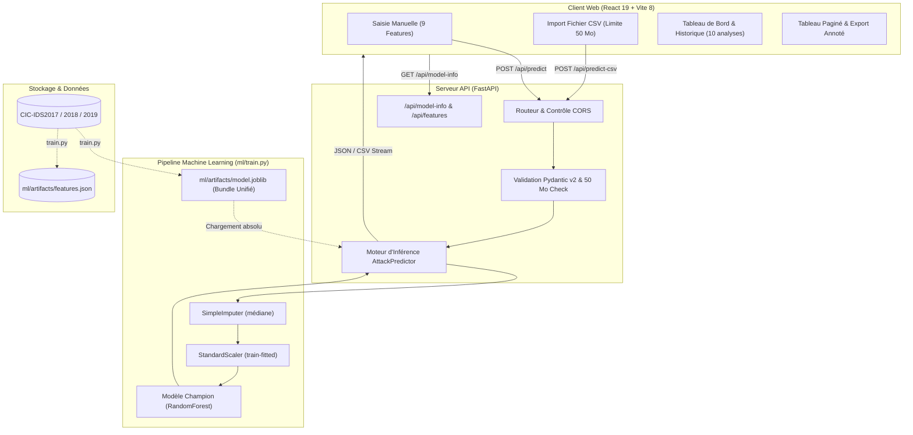

# Architecture Technique - Attack Watcher

Ce document détaille l'architecture globale, les choix de conception, le pipeline d'apprentissage automatique (Machine Learning) et les flux de données du système **Attack Watcher**.

---

## 1. Vue d'Ensemble du Système

Attack Watcher est conçu selon une architecture découplée trois tiers :
1. **Couche Présentation (Frontend)** : Interface web réactive construite avec React 19, Vite 8, Tailwind CSS et Lucide Icons.
2. **Couche Service & Inférence (Backend)** : API REST asynchrone haute performance propulsée par FastAPI et Pydantic v2.
3. **Couche Apprentissage & Artefacts (Machine Learning)** : Pipeline d'entraînement réel (Random Forest et XGBoost), imputation médiane, standardisation sans fuite et sérialisation unifiée.

---

## 2. Pipeline Machine Learning

### 2.1. Sélection des 9 Caractéristiques (Sans Destination Port)
La variable `Destination Port` a été retirée pour limiter la dépendance du modèle au port de capture et éviter le surapprentissage sur des services fixes (80, 443). Le modèle s'appuie strictement sur 9 métriques de dynamique de flux :

| Feature | Description | Rôle dans la détection |
| :--- | :--- | :--- |
| `Flow Duration` | Durée totale du flux (μs) | Identifie les flux asymétriques ultra-courts ou anormaux. |
| `Total Fwd Packets` | Nombre de paquets émis | Révèle les volumes massifs de requêtes d'inondation. |
| `Total Backward Packets` | Nombre de paquets en réponse | Révèle l'absence ou la quasi-absence de réponses du serveur saturé. |
| `Total Length of Fwd Packets` | Volume total des octets émis | Analyse de la charge utile émise par l'attaquant. |
| `Total Length of Bwd Packets` | Volume total des octets reçus | Mesure la réponse applicative du serveur cible. |
| `Bwd Packet Length Std` | Écart-type taille paquets retour | Indique une régularité suspecte ou l'absence de trafic retour. |
| `Flow Packets/s` | Débit moyen en paquets/seconde | Métrique critique d'inondation de paquets (packet storm). |
| `Flow IAT Mean` | Intervalle moyen entre paquets | Détecte une fréquence d'émission anormalement élevée. |
| `ACK Flag Count` | Présence du drapeau TCP ACK | Analyse le protocole de signalement TCP. |

### 2.2. Prévention Stricte des Fuites de Données (Zero Leakage)
Pour garantir la rigueur scientifique et l'étanchéité des évaluations :
- Le nettoyage des données (suppression des espaces des noms de colonnes, conversion des valeurs `+inf` et `-inf` en `NaN`, élimination des doublons) est appliqué en amont.
- Le découpage des données (Stratégie Leave-One-Dataset-Out ou split stratifié 80/20) est réalisé avant tout traitement statistique.
- L'imputation médiane (`SimpleImputer(strategy='median')`) et la normalisation (`StandardScaler()`) sont intégrées dans la même `Pipeline` scikit-learn que le classifieur.
- L'appel `pipeline.fit(X_train, y_train)` assure que la médiane, la moyenne et l'écart-type sont calculés exclusivement sur les données d'apprentissage. Le jeu de test n'est jamais fitté.

### 2.3. Benchmark et Modèle Champion
Le script `ml/train.py` exécute un banc d'essai réel entre deux algorithmes sur le jeu de test externe held-out (41 931 flux réels) :
- **Random Forest Classifier** : 100 estimateurs, profondeur maximale 12, parallélisé.
- **XGBoost Classifier** : 100 estimateurs, profondeur maximale 6, learning rate 0.1.

Résultats mesurés sur le test externe :
- **Random Forest (Champion)** : F1-Score = 0.9996, Précision = 0.9999, Rappel = 0.9993, ROC-AUC = 1.0000.
  - Matrice de confusion : TN = 16 433, FP = 2, FN = 18, TP = 25 478.
- **XGBoost** : F1-Score = 0.9996, Précision = 0.9999, Rappel = 0.9993, ROC-AUC = 1.0000.

Le pipeline champion est sérialisé dans `ml/artifacts/model.joblib` avec l'ensemble des métadonnées (version, date ISO, datasets, matrice de confusion réelle).

---

## 3. Architecture Backend (FastAPI)

### 3.1. Organisation Modulaire
- `backend/app/main.py` : Point d'entrée de l'application, gestion du cycle de vie asynchrone (`lifespan`), middleware CORS et contrôleurs de routes.
- `backend/app/config.py` : Résolution dynamique des chemins absolus du projet et définition de la taille maximale des fichiers (50 Mo).
- `backend/app/schemas.py` : Schémas Pydantic v2 validant les 9 features requises, les statistiques de lot (`total_rows`, `error_rows`, `normal_count`, `ddos_count`) et le schéma `ModelInfoResponse`.
- `backend/app/predictor.py` : Service d'inférence chargeant le bundle d'artefacts ML absolu et appliquant les prédictions vectorisées sans aucune donnée simulée.

### 3.2. Contrat des Points d'Accès

| Méthode | Route | Rôle | Format Réponse |
| :--- | :--- | :--- | :--- |
| `GET` | `/api/health` | Contrôle d'état et disponibilité du modèle | JSON (`HealthResponse`) |
| `GET` | `/api/model-info` | Version, datasets, date d'entraînement et métriques réelles | JSON (`ModelInfoResponse`) |
| `GET` | `/api/features` | Métadonnées descriptives des 9 features | JSON (`FeaturesMetadataResponse`) |
| `POST` | `/api/predict` | Classification unitaire d'un flux (9 features) | JSON (`SinglePredictionResponse`) |
| `POST` | `/api/predict-csv` | Analyse par lot de fichiers CSV (limite 50 Mo) | JSON (`CsvPredictionResponse`) |
| `POST` | `/api/download-annotated-csv` | Téléchargement du CSV avec colonnes de verdict et probabilités | Fichier CSV annoté |

### 3.3. Gestion des Erreurs et Robustesse
- **Colonnes manquantes** : Si le fichier CSV ne contient pas l'intégralité des 9 features requises, l'API rejette la requête avec le code HTTP 400 et détaille la liste exacte des colonnes absentes.
- **Dépassement de taille** : Tout téléversement excédant 50 Mo est interrompu avec le code HTTP 413 (Content Too Large).
- **Valeurs aberrantes** : Les valeurs textuelles non convertibles sont comptabilisées dans `error_rows` et imputées par la médiane calculée sur le train set.

---

## 4. Architecture Frontend (React 19 + Vite 8)

### 4.1. Composants d'Interface
- `ConsoleSection.jsx` : Conteneur principal offrant l'accès alterné à la saisie unitaire et à l'analyse CSV.
- `ManualPrediction.jsx` : Formulaire des 9 features réseau avec présélections réelles issues du dataset.
- `CsvPrediction.jsx` : Zone de glisser-déposer, validation locale, analyse vectorisée et historique des 10 derniers lots.
- `MetricsOverview.jsx` : Cartes métriques réelles (Flux Analysés, Lignes en Erreur, Trafic Normal, Attaques DDoS, Taux d'Attaque).
- `ResultsTable.jsx` : Tableau paginé affichant les lignes, le verdict, la probabilité DDoS (uniquement si fournie) et les métriques de paquets.
- `BenchmarkSection.jsx` : Affichage dynamique des performances réelles issues de `/api/model-info`.

### 4.2. Moteur Edge ML (Repli Navigateur)
Pour garantir une disponibilité continue même sur hébergement statique ou en cas d'indisponibilité du serveur, le fichier `frontend/src/services/edgeML.js` intègre les 100 arbres de décision et le StandardScaler exportés à l'entraînement, assurant une inférence locale stricte sur les 9 features.

---

## 5. Limites et Périmètre Opérationnel

1. **Généralisation Inter-Datasets (Domain Shift)** :
   La détection DDoS par apprentissage supervisé peut subir des variations lorsque le modèle est confronté à des environnements réseau dont les topologies, les latences moyennes ou les charges applicatives diffèrent substantiellement de celles de CIC-IDS2017 / 2018 / 2019.
2. **Périmètre des Attaques Couvertes** :
   Le modèle est optimisé pour les attaques par déni de service volumétriques et par épuisement d'état (ex: SYN Flood, UDP Flood, HTTP Flood). Les attaques de niveau applicatif sans anomalie de débit (ex: injections SQL, cross-site scripting) ainsi que les attaques furtives à débit ultra-faible (ex: Slowloris) sortent du champ d'action de ce classifieur de flux.
3. **Absence du Port de Destination** :
   La suppression de `Destination Port` empêche le modèle de surapprendre sur des ports cibles spécifiques mais impose une sensibilité accrue à la régularité statistique des flux et aux variations temporelles d'inter-arrivée.
