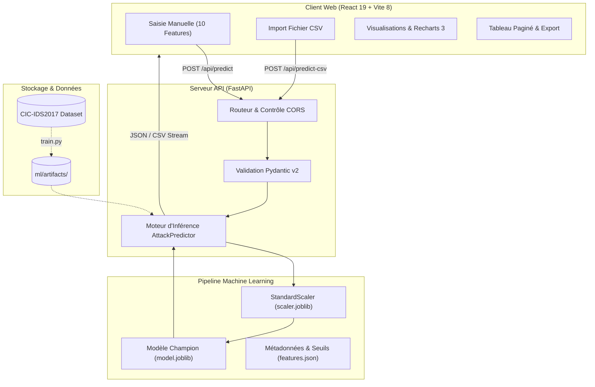

# Architecture Technique - Attack Watcher

Ce document détaille l'architecture globale, les choix de conception, le pipeline d'apprentissage automatique (Machine Learning) et les flux de données du système **Attack Watcher**.

---

## 1. Vue d'Ensemble du Système

Attack Watcher est conçu selon une architecture découplée trois tiers :
1. **Couche Présentation (Frontend)** : Interface web réactive construite avec React 19, Vite 8, Tailwind CSS et Recharts 3.
2. **Couche Service & Inférence (Backend)** : API REST asynchrone haute performance propulsée par FastAPI et Pydantic v2.
3. **Couche Apprentissage & Artefacts (Machine Learning)** : Pipeline d'entraînement, normalisation et benchmarking comparatif (Random Forest vs XGBoost) avec sérialisation des modèles.

---

## 2. Pipeline Machine Learning

### 2.1. Sélection des Caractéristiques Réseau
Le modèle s'appuie sur un sous-ensemble de 10 variables issues du standard CIC-IDS2017, sélectionnées pour leur fort pouvoir discriminant face aux attaques par inondation (SYN Flood, HTTP Flood, UDP Flood) :

| Feature | Description | Rôle dans la détection |
| :--- | :--- | :--- |
| `Destination Port` | Port réseau cible | Détecte le ciblage massif de services spécifiques (80, 443). |
| `Flow Duration` | Durée totale du flux (μs) | Identifie les flux asymétriques ultra-courts ou anormaux. |
| `Total Fwd Packets` | Nombre de paquets émis | Révèle les volumes massifs de requêtes d'inondation. |
| `Total Backward Packets` | Nombre de paquets en réponse | Révèle l'absence ou la quasi-absence de réponses du serveur saturé. |
| `Total Length of Fwd Packets` | Volume total des octets émis | Analyse de la charge utile émise par l'attaquant. |
| `Total Length of Bwd Packets` | Volume total des octets reçus | Mesure la réponse applicative du serveur cible. |
| `Bwd Packet Length Std` | Écart-type taille paquets retour | Indique une régularité suspecte ou l'absence de trafic retour. |
| `Flow Packets/s` | Débit moyen en paquets/seconde | Métrique critique d'inondation de paquets (packet storm). |
| `Flow IAT Mean` | Intervalle moyen entre paquets | Détecte une fréquence d'émission anormalement élevée. |
| `ACK Flag Count` | Présence du drapeau TCP ACK | Analyse le protocole de signalement TCP. |

### 2.2. Prévention Stricte des Fuites de Données (Data Leakage)
Pour garantir la validité statistique des résultats en production :
- Le nettoyage des données (gestion des `NaN`, remplacement des valeurs `+inf` et `-inf`, suppression des doublons) est appliqué en amont.
- Le **split stratifié** (`train_test_split(stratify=y, test_size=0.2, random_state=42)`) est appliqué **strictement avant** toute opération de normalisation.
- Le `StandardScaler` est ajusté (**fit**) exclusivement sur le jeu d'entraînement (`X_train`), puis appliqué (**transform**) sur `X_train` et `X_test`.

### 2.3. Benchmark et Sélection du Modèle
Le script `ml/train.py` compare deux algorithmes sur le jeu de test :
- **Random Forest Classifier** : Ensemble d'arbres décisionnels avec limitation de la profondeur pour éviter le surapprentissage.
- **XGBoost Classifier** : Algorithme de Gradient Boosting optimisé avec fonction de perte `binary:logistic`.

Le modèle obtenant le meilleur score F1 sur la classe positive (DDoS) est automatiquement désigné comme **modèle champion** et sérialisé dans `ml/artifacts/model.joblib`.

---

## 3. Architecture Backend (FastAPI)

### 3.1. Organisation Modulaire
- `backend/app/main.py` : Point d'entrée de l'application, cycle de vie asynchrone (`lifespan`), middleware CORS et contrôleurs de routes.
- `backend/app/config.py` : Résolution dynamique des chemins absolus du projet et configuration des origines autorisées.
- `backend/app/schemas.py` : Schémas Pydantic v2 assurant la validation des données d'entrée, la gestion des alias de colonnes (tolérance aux espaces) et le typage strict des réponses.
- `backend/app/predictor.py` : Service d'inférence encapsulant le modèle et le scaler sérialisés. Traite aussi bien l'inférence unitaire que les traitements par lot vectorisés.

### 3.2. Contrat des Points d'Accès

| Méthode | Route | Rôle | Format Réponse |
| :--- | :--- | :--- | :--- |
| `GET` | `/api/health` | Contrôle d'état et disponibilité du modèle | JSON (`HealthResponse`) |
| `GET` | `/api/features` | Métadonnées des 10 features et benchmark | JSON (`FeaturesMetadataResponse`) |
| `POST` | `/api/predict` | Classification d'un flux réseau individuel | JSON (`SinglePredictionResponse`) |
| `POST` | `/api/predict-csv` | Classification par lot d'un fichier CSV | JSON (`CsvPredictionResponse`) |
| `POST` | `/api/download-annotated-csv` | Export du CSV avec colonnes de prédiction | Fichier téléchargeable (`text/csv`) |

---

## 4. Architecture Frontend (React + Vite)

### 4.1. Structure des Composants
- `App.jsx` : Composant racine gérant le chargement initial des métadonnées, l'état de l'API et la bascule entre les onglets.
- `components/Header.jsx` : Barre de navigation supérieure avec badge dynamique de santé et modèle chargé.
- `components/ManualPrediction.jsx` : Formulaire interactif 10 features, boutons d'échantillons pré-remplis, jauge de probabilité animée et badge de verdict coloré.
- `components/CsvPrediction.jsx` : Zone de dépôt de fichiers (drag and drop), barre d'état et déclenchement de l'analyse par lot.
- `components/MetricsOverview.jsx` : Indicateurs de synthèse statistique (total analysé, normaux, attaques, pourcentage).
- `components/Visualizations.jsx` : Graphiques vectoriels Recharts (diagramme en anneau et distribution par niveau de risque).
- `components/ResultsTable.jsx` : Tableau de données paginé, filtrable par verdict et recherchable par port.

### 4.2. Flux de Données Client
Les échanges réseau sont centralisés dans `frontend/src/services/api.js`. Un reverse proxy configuré dans `vite.config.js` relaie automatiquement les requêtes `/api/*` vers `http://localhost:8000` en phase de développement.

---

## 5. Pipeline d'Intégration Continue (CI)

Le pipeline GitHub Actions (`.github/workflows/ci.yml`) s'exécute sur `push` et `pull_request` :
- **Job Backend** :
  - Environnement Python 3.13 sous Ubuntu.
  - Mise en cache des paquets `pip`.
  - Contrôle statique avec `ruff check backend`.
  - Exécution des tests automatisés avec `pytest backend/tests -v`.
- **Job Frontend** :
  - Environnement Node.js LTS (v20) sous Ubuntu.
  - Mise en cache `npm`.
  - Installation déterministe avec `npm ci`.
  - Analyse statique avec `npm run lint`.
  - Validation de la compilation de production avec `npm run build`.

---

## 6. Sources et Références Académiques

1. **Jeu de données de référence** :
   - Université du Nouveau-Brunswick (UNB) - Canadian Institute for Cybersecurity (CIC).
   - Dataset : *CIC-IDS2017 (Friday-WorkingHours-Afternoon-DDos.pcap_ISCX.csv)*.
   - Lien officiel : [UNB CIC-IDS2017](https://www.unb.ca/cic/datasets/ids-2017.html)

2. **Publication scientifique de référence** :
   - Iman Sharafaldin, Arash Habibi Lashkari, and Ali A. Ghorbani, *"Toward Generating a New Dataset for Security Analysis: Towards Developing Newer Intrusion Detection Datasets"*, Communications in Computer and Information Science, 2018.

3. **Technologies et Outils** :
   - [Scikit-learn Documentation](https://scikit-learn.org/stable/)
   - [XGBoost Documentation](https://xgboost.readthedocs.io/)
   - [FastAPI Documentation](https://fastapi.tiangolo.com/)
   - [Pydantic v2 Documentation](https://docs.pydantic.dev/latest/)
   - [React 19 Documentation](https://react.dev/)
   - [Vite Documentation](https://vite.dev/)
   - [Recharts Documentation](https://recharts.org/)
   - [Lucide Icons](https://lucide.dev/)
